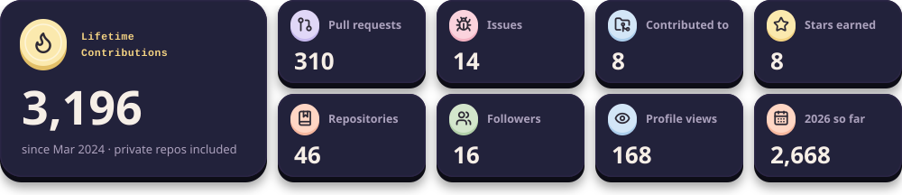
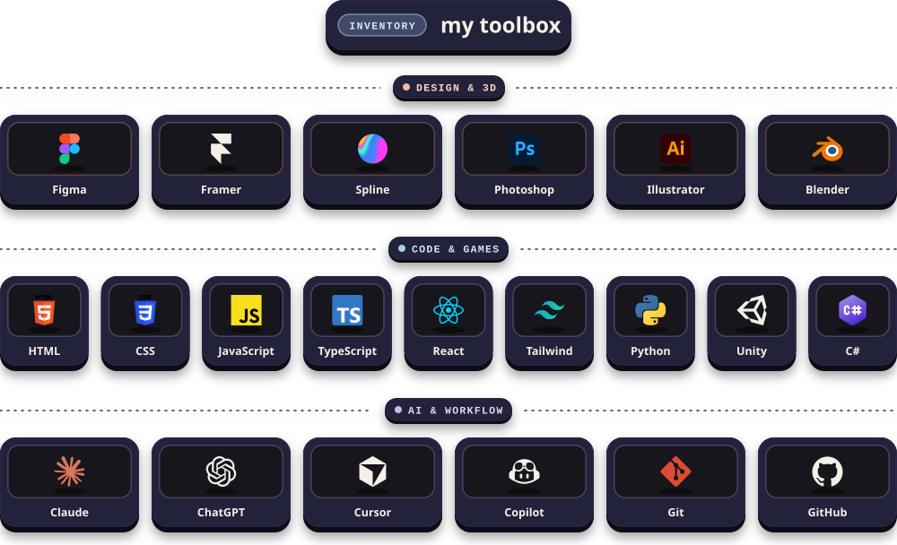

<!-- The artwork in assets/ is drawn by .github/scripts/draw_assets.py; the stats, streak, languages and snake panels are
     redrawn every 3 hours by .github/workflows/profile-assets.yml (stat_cards.py, frame_snake.py) into the output branch. -->

<!-- one line with no spaces, so the five 20% tiles fill the row like the stat tiles -->

  

&nbsp;

  

  

<!-- invisible counter that records profile views; the stats above read its total -->

